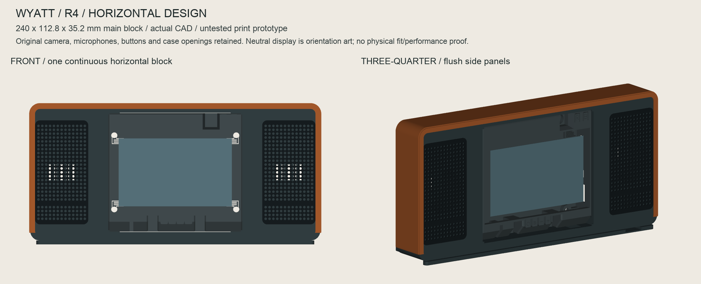

# Wyatt

A quieter place to start the day. Wyatt is a developing desk and bedside companion; this first public release shares its owner-selected **R4 horizontal enclosure** for the ESP32-S31-Korvo-1.

**v0.1.0-r4 is CAD-only prototype material.** It contains editable STEP/STP, printable STL, parametric source, a print manifest, supplier references and fit-test instructions. It does not include installable Wyatt firmware, backend software or a finished consumer product.



*Native CAD preview of the released geometry with a neutral display. This is not a product photograph or a physically fitted case.*

## The selected layout

One continuous charcoal front places two front-facing speakers to the left and right of the original Korvo screen. Cognac leather is proposed for the top and sides. The SHT40 breakout has an isolated, ventilated internal cell below the left speaker; the rear opens for servicing. The original inner case and its camera, microphone and control openings are retained.

The main block is **240 × 112.8 × 35.2 mm**. With its low concealed plinth, the printed assembly envelope is **240 × 116 × 60 mm**. This USB-powered prototype has no claimed battery runtime. The source is designed around the original official inner case, two measured 42 mm speaker rims with different 17/20 mm listed depths, and the DFRobot SEN0428 14 × 17 mm breakout. Component variants require their own fit checks.

## Start here

1. Read [print-first instructions](hardware/r4/README-PRINT-FIRST.txt) and the [print manifest](hardware/r4/PRINT-MANIFEST.json). Print the six fit coupons and their specified companion parts before the full shell.
2. Check the real cassette, cables, SD/control access, both speaker cones, sensor stack and seals. [TEST06](hardware/r4/STL/TEST_06_Cassette_Port_Lane_Coupon.stl) tests the limiting port lanes before a 240 mm print.
3. Use [STL meshes](hardware/r4/STL/) for slicing or [STEP/STP files](hardware/r4/STP/) for CAD inspection. Do not print the assembly or `REFERENCE_*` files as a fused part. Keep millimetres and 100% scale.

A Bambu P1S fits the nominal main-shell envelope with a centred 5 mm brim, subject to checking the complete slice and machine exclusions. This is a geometric check, not a completed slice or print. See [P1S notes](hardware/r4/P1S-printing.txt), [camera/selfie clearance](hardware/r4/Camera-and-selfies.txt), the [Chinese printer handoff](hardware/r4/松江打印店-分阶段报价与验收.txt) and [dated China procurement reference](hardware/r4/BUY-NOW-China.html). The procurement estimate excludes hardware already owned by the original bench builder; it is not a complete build price.

## What is validated

Native CAD and mesh checks are recorded in the [package validation](hardware/r4/package-validation.json) and [independent review](hardware/r4/Independent-CAD-QA.json). The sensor PCB reference is intentionally a planform, not an assembled module. No R4 case has yet been printed, fitted or thermally/acoustically qualified. Actual camera framing, connector entry, sensor component clearance, foam compression, cone excursion and desk stability remain physical gates. [Build status](docs/BUILD_STATUS.md) separates these facts from planned work.

## Building toward the full Wyatt

The intended product brings an alarm, a useful daily agenda, room/weather information and short conversations to a calm interface. Public DIY firmware/backend instructions will follow their own validation; no release date is promised. Assembled, tested Wyatt units are planned after prototype and production validation. They are not available to order from this release. Kickstarter campaign URL: **pending**.

Community design suggestions and measured build reports are welcome. Please read [CONTRIBUTING](CONTRIBUTING.md), the [roadmap](docs/ROADMAP.md) and [campaign/AI-assistance notes](docs/KICKSTARTER.md); keep credentials, calendar data and personal photos out of reports.

## Rebuild the CAD

Use Python 3.12 and a fresh virtual environment. The exact package versions used for this release are pinned in [requirements-cad.txt](requirements-cad.txt); platform wheels and graphics support may vary.

```sh
python3.12 -m venv .venv-cad
. .venv-cad/bin/activate
python -m pip install -r requirements-cad.txt
python hardware/r4/validate_package.py
# These overwrite the generated CAD/reports and previews in hardware/r4:
python hardware/r4/build_horizontal_case.py
python hardware/r4/validate_package.py
python hardware/r4/render_technical_preview.py
```

Model dimensions are driven by literals in `build_horizontal_case.py`; editing `parameters.json` alone does not rebuild the model. STEP exporter timestamps/metadata can differ on regeneration; the original release hashes are in [GEOMETRY-SHA256SUMS.txt](hardware/r4/GEOMETRY-SHA256SUMS.txt). The renderer uses a neutral orientation surface by default. Its optional `--illustrative-ui` shows a legacy development UI image, which is illustrative and does not imply released software.

## Credit and license

The original inner-case assets are by Espressif Systems (Shanghai) Co., Ltd., pinned to [esp-dev-kits commit bd4d4ac](https://github.com/espressif/esp-dev-kits/tree/bd4d4ac18657e73583af3d7c0b0a23c3cddf3735/examples/esp32-s31-korvo/3d-printed-case). Original files, derived CAD, parametric geometry source and drawings retain **CC BY-SA 4.0**; preserve [attribution](hardware/r4/ATTRIBUTION.txt) and [license terms](LICENSE-CC-BY-SA.txt), including when distributing adapted physical designs. Espressif does not endorse Wyatt. No trademark or patent clearance is represented.

Wyatt was formerly developed as Shannon. Historical filenames, original geometry metadata and one optional UI illustration retain that name to keep references stable; they are part of this same R4 design history. Later software will have its own release and license.
